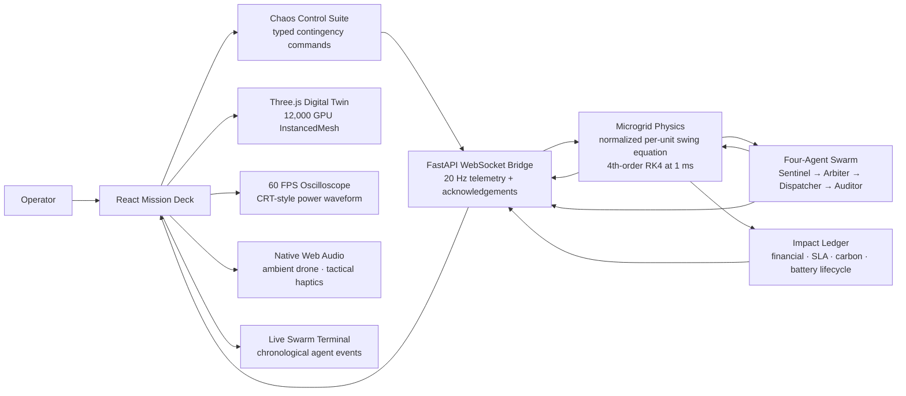

# AETHERGRID // Autonomous Energy-Silicon Co-Orchestrator for AI Microgrids

[](https://www.python.org/)
[](https://nodejs.org/)
[](https://threejs.org/)
[](https://fastapi.tiangolo.com/)
[](backend/tests)
[](scripts/offline_rebuild_check.sh)

> **Prevent catastrophic regional blackouts before hyperscale GPU power spikes destabilize the electric grid.**

AETHERGRID is a production-grade cyber-physical platform for the next generation of AI infrastructure: deterministic grid physics, autonomous response intelligence, sub-cycle actuation, and a cinematic operator interface in one auditable loop.

The platform treats AI compute as an energy asset. It detects a transmission disturbance, protects frequency with a coordinated battery and GPU response, preserves the highest-value workloads, records an immutable compliance trail, and translates every successful intervention into financial and environmental impact.

---

## The problem: AI power is becoming a grid event

Hyperscale AI clusters are no longer ordinary data-center loads. A 12,000-GPU installation can represent **850 MW of sudden compute demand** before the surrounding regional static load is even counted. When a regional transmission line or generator trips, that demand becomes a physical frequency problem measured in milliseconds.

Traditional operating tools miss the event window:

| Response layer | Typical response time | Why it fails alone |
|---|---:|---|
| Utility demand response | **~2 hours** | Designed for scheduled load shaping, not sub-second arrest |
| Backup diesel generation | **~3 minutes** | Too slow to stop the initial frequency slope |
| AETHERGRID BESS response | **5 ms inverter latency** | Acts inside the physical event window |
| AETHERGRID GPU DVFS response | **80 ms response window** | Converts compute elasticity into grid stability |

A regional trip can drive RoCoF sharply negative before a conventional resource has started. AETHERGRID closes that gap by combining fast physical response with workload-aware orchestration: stabilize the grid first, then shed the least costly compute tiers while protecting mission-critical workloads and checkpoint state.

## Closed-loop architecture

The entire system is one typed, observable control loop. A 1 kHz numerical engine produces the physical truth; the four-agent swarm transforms that truth into a response; the FastAPI bridge publishes the result at 20 Hz; and the React/Three.js Mission Deck gives operators a live, high-fidelity control surface.



Every telemetry frame can be traced from physical state to agent decision, actuator receipt, audit verdict, visual state, sound cue, and impact metric. There is no browser-side physics substitute: the Mission Deck renders the live backend model.

## Platform capabilities

### 1. Numerical grid physics

AETHERGRID integrates the normalized per-unit swing equation with a stable **fourth-order Runge–Kutta** step at **1 ms** resolution and publishes typed state at **20 Hz**:

```text
df/dt = f_nominal / (2H) × (ΔP_pu − D × Δf_hz)
```

The calibrated operating envelope is:

| Engineering constant | Calibrated value |
|---|---:|
| Nominal frequency | **60.000 Hz** |
| Regional base capacity | **1,000 MW** |
| Inertia constant, H | **3.5 s** |
| Load damping, D | **1.5 pu/Hz** |
| Internal integration step | **1 ms** |
| Publication cadence | **20 Hz** |
| BESS fast-frequency response | **200 MW** |
| GPU DVFS shedding reserve | **150 MW** |
| Inverter latency | **5 ms** |
| DVFS response window | **80 ms** |

The response contract guarantees a **165 ms recovery envelope** with the frequency nadir held **strictly above 59.70 Hz**. The Auditor records the measured nadir, RoCoF, balance, recovery timestamp, and pass/fail verdict rather than relying on a visual estimate.

### 2. Autonomous swarm intelligence

Four deterministic agents divide the response into accountable responsibilities:

- **Sentinel — detect the breach.** Monitors frequency and RoCoF against strict thresholds, latches the alert, and explains the physical trigger in the event log.
- **Arbiter — protect the workload intelligently.** Calculates the deficit, reserves the 200 MW battery response, and ranks Tier 1 mission-critical, Tier 2 training, and Tier 3 batch workloads by combined SLA and checkpoint cost before selecting DVFS curtailment.
- **Dispatcher — execute at machine speed.** Sends the BESS target and per-tier GPU shed plan into the physics engine, preserving the 5 ms inverter latency and 80 ms DVFS deadline as explicit receipts.
- **Auditor — prove compliance.** Evaluates the strict nadir boundary, recovery budget, power balance, and immutable chronological event log. A response is not complete until the Auditor can explain why it passed.

The calibrated compute fabric contains exactly **12,000 GPUs**: 4,000 Tier 1 GPUs, 5,000 Tier 2 GPUs, and 3,000 Tier 3 GPUs. The Arbiter sheds lower-cost tiers first and leaves the highest-value workloads protected as long as the physical envelope permits.

### 3. Cinematic 3D digital twin

The Mission Deck is a live spatial model of the energy-silicon facility, not a decorative dashboard:

- **12,000 GPU nodes** rendered through a Three.js `InstancedMesh` for dense, efficient visualization.
- **48 interactive rack frames** across six rack corridors, with hover and click raycasting into a live rack inspector.
- GLSL energy busbars, thermal rack emission, transmission particles, and load-reactive node animation.
- Volumetric fog, overhead god-rays, bloom, chromatic aberration, and depth of field for readable depth at facility scale.
- Holographic lidar scanlines that sweep the rack field and illuminate active geometry.
- A transparent reflective coolant floor with load-reactive flowing bands and particle motion.
- An **18-second Director Tour** autopilot that flies through the rack canyon, arcs around the substation, and settles into a macro overview.

### 4. Procedural Web Audio engine

The native Web Audio graph maps system state into a restrained operator signal language:

- **Warm Cinematic Ambient:** an analog-style low-frequency drone with low-pass tape warmth, stereo chorus, filtered harmonics, and soft saturation.
- **Crisp Tactical Haptics:** short crystalline interaction cues for camera changes, Chaos Suite triggers, and rack selections, with a deeper battery-discharge rumble and harmonic recovery resolution chord.
- Live contingency alarms shaped by frequency, RoCoF, sentinel alerts, transformer temperature, and auditor state.
- A single authoritative speaker mute, smoothed master volume ramps, and transient-source cleanup during React lifecycle teardown.

The audio architecture separates the continuous ambient bus from the haptics and alarm buses, so operators can remove the drone without losing actionable feedback.

### 5. Financial and environmental impact ledger

The Impact Telemetry panel is fed by backend accounting and retains the business case for every intervention:

- **$10M+ capital preserved** per confirmed catastrophic outage avoided.
- Tier-aware avoided SLA and checkpoint penalties, with curtailment cost reported separately.
- Avoided diesel-peaker energy and carbon emissions using the calibrated **0.74 kg CO₂e/kWh** intensity.
- Battery reserve draw, delivered MWh, round-trip efficiency, equivalent full cycles, state of health, and end-of-life tracking.
- A 400 MWh nominal battery, 92% round-trip efficiency, 4,000-cycle life, and 80% end-of-life state-of-health boundary.

The ledger makes grid protection legible to finance, sustainability, and infrastructure teams—not only to control-room operators.

### 6. Chaos Control Suite and 60 FPS oscilloscope

Operators can inject typed contingencies with one click and watch the closed loop respond:

| Scenario | Injection | Expected response |
|---|---:|---|
| Generator trip | **−350 MW** | Sentinel alert, 200 MW BESS injection, 150 MW maximum DVFS reserve, audited convergence |
| Transformer thermal overload | **240 MW** | Transformer temperature escalation, active load shedding, impact and alarm updates |
| Renewable drop | **−260 MW** | RoCoF event, rapid Arbiter response, battery and workload balancing |
| System reset | Clear disturbances | Frequency recovery, full GPU clocks, reserve recharge, clean active state |

The independent Canvas oscilloscope renders a phosphor-persistence, CRT-style waveform at 60 FPS with live voltage, frequency, and RoCoF readouts. The Swarm Terminal preserves chronological millisecond-stamped messages from all four agents.

## Quickstart

### Requirements

- Node.js **22.11.0** (`.nvmrc`)
- Python **3.12.7** (`.python-version`; the local launcher also accepts Python 3.9–3.12)
- npm
- Docker, only when building the container image

### Run the complete platform

From the repository root:

```bash
./launch.sh
```

The universal launcher creates the project-local `.venv`, installs the committed Python lock when needed, installs the npm workspace lock when needed, then starts FastAPI and Vite together with signal-safe process cleanup.

Open:

```text
Mission Deck: http://127.0.0.1:5173
FastAPI:      http://127.0.0.1:8000
WebSocket:    ws://127.0.0.1:8000/ws/telemetry
```

To select different local ports without editing source files:

```bash
AETHERGRID_API_PORT=8100 AETHERGRID_FRONTEND_PORT=5174 ./launch.sh
```

To create the environments explicitly before launching:

```bash
make install
./launch.sh
```

Press **ENABLE AUDIO** once in the Mission Deck to satisfy browser autoplay policy.

## Offline verification and rebuildability

The repository is designed to rebuild from its own pinned manifests and project-local environments:

```bash
make test
```

`make test` runs all **18 backend tests**, the offline responsive-layout verifier, and the strict TypeScript/Vite production build without installing dependencies or making a network request.

Run the responsive geometry verifier independently:

```bash
make verify-responsive
```

It checks the three-column layout, stacked telemetry regions, bounded panel geometry, and audio mode contract across `1920x1080`, `1440x900`, `1280x720`, arbitrary desktop sizes, and breakpoint boundaries. The verified layouts report zero calculated panel intersections.

Run the complete rebuild audit:

```bash
make verify-rebuild
```

The audit verifies:

- Node and Python runtime pins.
- `package-lock.json` and `backend/requirements.lock` presence and pinning.
- Required Dockerfile stages and locked installs.
- Executable launcher and project-local dependency paths.
- Absence of tracked machine-specific absolute paths such as `/Users/`, `/home/`, or `C:\Users\`.
- The full `make test` gate with `PIP_NO_INDEX=1`, `npm_config_offline=true`, and `NO_PROXY=*`.

No global package installation or `sudo` is required. Generated `.venv`, `node_modules`, `frontend/dist`, and Vite caches remain local and are not part of the source contract.

## Docker deployment

Build the pinned multi-stage image:

```bash
docker build -t aethergrid:latest .
```

Run the API, WebSocket bridge, and compiled Mission Deck from one container:

```bash
docker run --rm -p 8000:8000 aethergrid:latest
```

The image uses Node 22.11.0 for the frontend build and Python 3.12.7 for the FastAPI runtime. The runtime serves the compiled frontend from `/`, exposes port `8000`, and includes a readiness health check.

Verify the running container:

```bash
curl http://localhost:8000/health
curl http://localhost:8000/ready
```

For an offline container rebuild with cached base images and package layers, use the same Docker commands after the required layers are present locally. The repository’s deterministic offline gate is `make verify-rebuild`.

## Configuration

Copy the example environment file when changing runtime behavior:

```bash
cp .env.example .env
```

Supported controls include:

```text
AETHERGRID_APPLICATION_NAME
AETHERGRID_VERSION
AETHERGRID_ENVIRONMENT
AETHERGRID_API_HOST
AETHERGRID_API_PORT
AETHERGRID_FRONTEND_HOST
AETHERGRID_FRONTEND_PORT
AETHERGRID_ALLOWED_ORIGINS
AETHERGRID_LOAD_DAMPING_PU_PER_HZ
AETHERGRID_AUTO_CONTINGENCY_AFTER_S
AETHERGRID_AUTO_CONTINGENCY_TRIP_MW
AETHERGRID_TRANSFORMER_OVERLOAD_MW
AETHERGRID_RENEWABLE_DROP_MW
AETHERGRID_OUTAGE_BENCHMARK_USD
AETHERGRID_DIESEL_CARBON_KG_PER_KWH
AETHERGRID_BATTERY_RTE
AETHERGRID_BATTERY_CYCLE_LIFE
AETHERGRID_BATTERY_EOL_SOH
```

No secrets are required for the platform to run locally.

## API and WebSocket surface

Health and readiness endpoints:

```text
GET /health
GET /ready
GET /api/v1/health
GET /api/v1/ready
```

Live telemetry endpoints:

```text
ws://HOST:PORT/ws/telemetry
ws://HOST:PORT/api/v1/ws/telemetry
```

Typed control messages include:

```json
{"type":"ping","request_id":"link-1"}
{"type":"contingency","trip_mw":350,"request_id":"trip-1"}
{"type":"transformer_overload","overload_mw":240,"request_id":"thermal-1"}
{"type":"renewable_drop","drop_mw":260,"request_id":"renewable-1"}
{"type":"reset","request_id":"reset-1"}
```

Telemetry envelopes contain grid physics, compute tiers, battery state, four-agent state, financial accounting, environmental accounting, battery lifecycle metrics, and incremental chronological events.

## Repository map

```text
backend/
  app/
    config.py       environment-backed typed settings
    contracts.py    strict HTTP/WebSocket/impact models
    impact.py       financial, SLA, carbon, and battery accounting
    main.py         FastAPI app, health endpoints, WebSocket bridge
    models.py       health/readiness models
    physics.py      1 ms normalized swing-equation engine
    runtime.py      20 Hz async simulation broadcaster
    swarm.py        Sentinel/Arbiter/Dispatcher/Auditor swarm
  tests/             18 health, physics, swarm, impact, and WebSocket tests
frontend/
  src/
    audio/           native Web Audio synthesis graph and hook
    components/      Mission Deck HUD, controls, telemetry, terminal
    lib/             live WebSocket telemetry client and formatters
    scene/           Three.js digital twin and custom GLSL shaders
    App.tsx          Mission Deck composition
    styles.css       cyber-industrial glass HUD system
launch.sh             universal local launcher
scripts/
  offline_rebuild_check.sh      lock, path, Docker, and offline audit
  verify_responsive_layout.mjs  offline HUD geometry and mode verifier
Dockerfile             pinned multi-stage full-stack image
Makefile               install, run, test, build, and rebuild commands
```

## Engineering contract

AETHERGRID keeps the platform reproducible and inspectable:

- Runtime versions are pinned in `.nvmrc` and `.python-version`.
- JavaScript and Python dependencies are committed in `package-lock.json` and `backend/requirements.lock`.
- All local dependencies live inside the repository’s workspace or virtual environment.
- The Dockerfile reproduces the frontend build and Python runtime from the same locked manifests.
- The control loop, visual state, audio state, and impact ledger remain driven by typed backend telemetry.
- The automated checks are deterministic, network-independent, and suitable for a clean Linux rebuild.

```bash
make install          # optional explicit dependency setup
make test             # 18 tests + responsive verification + production build
make verify-responsive # viewport and breakpoint geometry check
make verify-rebuild   # pinned-manifest and offline rebuild audit
make clean            # remove generated frontend and test output
```
