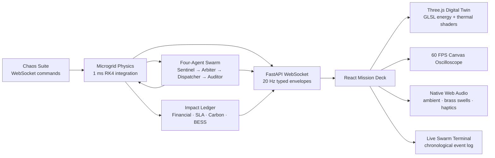

# AETHERGRID // Cyber-Physical Mission Deck

> **An autonomous energy-silicon co-orchestrator for preventing regional blackouts before hyperscale AI workloads become grid events.**

AETHERGRID is a full-stack cyber-physical war room that couples a normalized per-unit microgrid model, a four-agent response swarm, a live bidirectional WebSocket bridge, and a cinematic Three.js digital twin. Operators can inject controlled contingencies, observe millisecond-scale frequency behavior, hear the response state, and quantify the financial and carbon value of every successful intervention.

Turn 6 adds a two-mode procedural audio console, interaction haptics, a fluid three-column command HUD, and automated responsive-layout verification across desktop and resize breakpoints. The cinematic Director Tour, volumetric facility atmosphere, sweeping lidar illumination, transparent coolant-floor simulation, and interactive rack raycasting remain available.

## Executive value proposition

- **Protect the grid:** arrest generator, transformer, and renewable contingencies with a 1 kHz internal numerical solver.
- **Protect the workload:** coordinate sub-cycle battery response with 80 ms GPU DVFS shedding across 12,000 GPUs.
- **Protect the business:** quantify prevented-outage capital, avoided SLA/checkpoint penalties, and curtailment cost in USD.
- **Protect the environment:** measure diesel-peaker energy and carbon emissions avoided by fast frequency response.
- **Prove the result:** expose every grid state, agent decision, actuator action, audit verdict, and impact metric over a typed 20 Hz stream.

## Closed-loop architecture



The same backend frame drives the physics, the swarm, the impact ledger, the HUD, the 3D shader uniforms, the oscilloscope, and the audio engine. React state updates at the telemetry cadence; the Three.js and Canvas render loops remain independent for smooth visual output.

## Turn 5–6 cinematic and operator upgrades

- **Cinematic Ambient:** warm filtered sine/triangle drone, stereo chorus, resonant low-pass shaping, and soft tape saturation.
- **Tactical Haptics:** disables the continuous drone while retaining camera-switch, chaos-trigger, rack-selection, battery-discharge, and Auditor-resolution feedback.
- **Authoritative mute:** the dedicated speaker button is the only master mute control; soundscape selection never doubles as mute.
- **Director Tour:** an 18-second autopilot path that sweeps through the rack canyon, arcs around the substation, and settles into an elevated overview.
- **Volumetric atmosphere:** exponential depth fog, overhead grate lighting, and subtle directional god-ray shafts.
- **Lidar scanline:** a continuous floor scan that highlights rack wireframes and GPU instances as it crosses the facility.
- **Coolant floor:** transparent reflective metallic floor overlays with load-reactive flowing coolant bands and particles.
- **Rack raycasting:** hover or click a rack frame to open a glass inspection card with rack ID, tier, core temperature, MW draw, and GPU count.
- **Fluid command HUD:** left Tactical Rail, center viewport with bottom Chaos Suite/Swarm Terminal dock, and a stacked right telemetry column with the oscilloscope, impact ledger, and telemetry cards.
- **Responsive verification:** `scripts/verify_responsive_layout.mjs` checks the three-column geometry, bounded panel regions, audio options, and stacked/medium breakpoints without network access.

## Calibrated operating model

| Parameter | Value |
|---|---:|
| Nominal grid frequency | **60.000 Hz** |
| Regional base capacity | **1,000 MW** |
| System inertia constant | **3.5 s** |
| Load damping | **1.5 pu/Hz** |
| Internal physics step | **1 ms** |
| Published telemetry | **20 Hz** |
| Generator trip ceiling | **350 MW** |
| BESS fast-frequency response | **200 MW** |
| GPU DVFS shedding ceiling | **150 MW** |
| BESS inverter latency | **5 ms** |
| DVFS response window | **80 ms** |
| Auditor nadir boundary | **strictly above 59.70 Hz** |
| Auditor recovery budget | **under 300 ms** |

The engine integrates:

```text
df/dt = f_nominal / (2H) × (ΔP_pu − D × Δf_hz)
```

The 12,000-GPU aggregate facility model is divided into Tier 1 mission-critical, Tier 2 training, and Tier 3 batch workloads. The Arbiter applies configurable nonlinear SLA/checkpoint cost curves and sheds lower-cost tiers first.

## Turn 4 impact telemetry

The Mission Deck’s **Impact Telemetry** panel is fed by backend accounting, not browser estimates.

### Financial and SLA accounting

- Prevented catastrophic outage benchmark: **$10,000,000 per confirmed event**.
- Capital preserved: `prevented_outages × outage_benchmark_usd`.
- Tier-aware avoided SLA penalties use the existing Tier 1/2/3 SLA and checkpoint curves, converted to USD through a configurable accounting unit.
- Curtailment cost is shown separately so judges can distinguish protection value from workload intervention cost.
- Last-event recovery time and curtailed MW remain visible beside cumulative session totals.

### Carbon accounting

- Default avoided diesel-peaker intensity: **0.74 kg CO₂e/kWh**.
- Avoided diesel energy accumulates from live BESS delivery plus actual GPU demand shed during active contingencies.
- Avoided carbon is published in kilograms and metric tonnes.

### Battery lifecycle accounting

- Round-trip efficiency: **92%**.
- Nominal reserve: **400 MWh**, configurable.
- Lifecycle: **4,000 equivalent full cycles**.
- End-of-life state of health: **80%**.
- The panel shows reserve remaining, delivered MWh, equivalent cycles, state of health, and the reserve recharge performed by System Reset.

All impact assumptions are configurable through `.env` and are validated by strict Pydantic models.

## Mission Deck capabilities

### 3D holodeck

- 12,000 GPU nodes rendered through an instanced Three.js mesh.
- 48 rack units across six dense rack corridors.
- Subterranean cooling conduits and high-voltage transmission paths.
- GLSL energy busbars with load-reactive current velocity and brightness.
- Cyan → amber → infrared thermal rack emission.
- Procedural cooling and transmission particles.
- Unreal Bloom, chromatic aberration, and depth of field.
- Macro Orbit, Rack Canyon, and Transformer Inspection camera rigs.

### Procedural Web Audio

Press **ENABLE AUDIO** once to satisfy browser autoplay policy. The native Web Audio graph then provides:

- Continuous 60 Hz AC hum with subtle odd harmonics.
- Pitch movement from live frequency telemetry.
- Dual-frequency emergency siren for Sentinel/critical contingency states.
- Metallic relay clicks for Arbiter curtailment.
- Low-pass battery inverter rumble during large FFR injection.
- Affirmative harmonic chime on Auditor convergence.
- Tactical haptics for camera changes, chaos commands, and rack selections.
- Master volume and mute controls with smoothed gain ramps.

### 60 FPS oscilloscope

The oscilloscope is an independent HTML5 Canvas render loop with phosphor persistence, millihertz reticles, millisecond divisions, live voltage/frequency waveform drawing, and cyan/amber/red state transitions.

### Chaos Suite

| Scenario | Default action | Expected response |
|---|---:|---|
| Generator Trip | Remove **350 MW** | Sentinel alert, BESS injection, full DVFS reserve, sub-300 ms convergence |
| Transformer Thermal Overload | Apply **240 MW** derating | Transformer temperature warning, active load shedding, thermal/audio escalation |
| Renewable Intermittency Drop | Remove **260 MW** | Elevated RoCoF, rapid Arbiter response, battery and workload balancing |
| System Reset | Clear disturbances | 60 Hz balance, full GPU clocks, recharged BESS reserve, clean active state |

Every button sends a typed bidirectional WebSocket command. The resulting grid state, shader state, waveform, audio, financial ledger, and terminal feed all update from the backend response.

### Live swarm terminal

The terminal displays chronological millisecond-stamped events from:

- **Sentinel:** frequency and RoCoF breach detection.
- **Arbiter:** tier allocation, SLA rationale, and residual deficit.
- **Dispatcher:** BESS/DVFS actuator receipt.
- **Auditor:** nadir, balance, and recovery verdict.

Autoscroll can be paused manually without losing the bounded event history.

## Repository layout

```text
backend/
  app/
    config.py       environment-backed typed settings
    contracts.py    strict HTTP/WebSocket/impact models
    impact.py       financial, SLA, carbon, and BESS accounting
    main.py         FastAPI app, health endpoints, WebSocket bridge
    models.py       health/readiness models
    physics.py      1 ms normalized swing-equation engine
    runtime.py      20 Hz async simulation broadcaster
    swarm.py        Sentinel/Arbiter/Dispatcher/Auditor swarm
  tests/             health, physics, swarm, impact, and WebSocket tests
frontend/
  src/
    audio/           native Web Audio synthesis graph and hook
    components/      HUD, oscilloscope, chaos suite, impact panel, terminal
    lib/             live WebSocket telemetry client and formatters
    scene/           Three.js digital twin and custom GLSL shaders
    App.tsx          Mission Deck composition
    styles.css       cyber-industrial glass HUD system
launch.sh             universal local launcher
scripts/
  dev.sh              compatibility alias for launch.sh
  offline_rebuild_check.sh  lock/path/offline verification harness
  verify_responsive_layout.mjs  offline HUD geometry and mode verification
Dockerfile             pinned multi-stage full-stack image
Makefile               install, run, test, build, and rebuild-check commands
```

## Requirements and pinned manifests

- Node.js **22.11.0**, pinned in `.nvmrc`.
- Python **3.12.7** for Docker, pinned in `.python-version`.
- Local launcher accepts Python 3.9–3.12 so macOS and Debian developer environments can use their available `python3`; Docker remains pinned to 3.12.7.
- JavaScript lockfile: `package-lock.json`.
- Python lockfile: `backend/requirements.lock`.
- No global package installation or `sudo` is required.

## Single-command quickstart

From the repository root:

```bash
./launch.sh
```

The launcher:

1. Loads optional `.env` values.
2. Detects `PYTHON_BIN`, `python3`, or `python`.
3. Creates `.venv` inside the project if needed.
4. Installs the pinned Python lock only when required modules are absent.
5. Installs the npm lock only when the workspace is missing or invalid.
6. Starts FastAPI and Vite concurrently.
7. Prints the API, Mission Deck, and WebSocket URLs.
8. Traps signals and tears down both process trees without orphan PIDs.

`./scripts/dev.sh` remains a compatibility alias to the same launcher. To override ports without editing files:

```bash
AETHERGRID_API_PORT=8100 AETHERGRID_FRONTEND_PORT=5174 ./launch.sh
```

URLs:

```text
Mission Deck: http://127.0.0.1:5173
FastAPI:      http://127.0.0.1:8000
WebSocket:    ws://127.0.0.1:8000/ws/telemetry
```

## Docker quickstart

Build the complete full-stack image:

```bash
```

Run the API, WebSocket, and compiled Mission Deck from one container:

```bash
```

Open <http://localhost:8000> and verify:

```bash
curl http://localhost:8000/health
curl http://localhost:8000/ready
```

The Dockerfile uses Node 22.11.0 and Python 3.12.7, installs only the committed lockfiles, copies the compiled Vite output into the Python image, and includes a `/ready` health check.

## Offline verification and rebuildability

After dependencies have been installed once, the required offline gate is:

```bash
make test
```

`make test` runs all backend tests, the offline responsive-layout check, and the strict TypeScript/Vite production build. It performs no dependency installation and no network request.

The responsive-layout check can also be run independently:

```bash
make verify-responsive
```

It verifies `1920x1080`, `1440x900`, `1280x720`, two arbitrary desktop resizes, and the medium/stacked breakpoint boundaries. The latest run reported zero calculated panel intersections at every checked viewport.

The full rebuildability audit is:

```bash
make verify-rebuild
```

`scripts/offline_rebuild_check.sh` verifies:

- Node and Python pins.
- Presence of both lockfiles.
- Every Python lock entry is pinned.
- Required Dockerfile stages and locked installs.
- Executable launcher.
- No tracked absolute user paths such as `/Users/`, `/home/`, or `C:\Users\`.
- `make test` under `PIP_NO_INDEX=1`, `npm_config_offline=true`, and `NO_PROXY=*`.

For a Docker rebuild with cached base images and package layers:

```bash
```

## Configuration

Create a local environment file when needed:

```bash
cp .env.example .env
```

Supported values include:

```text
AETHERGRID_API_HOST
AETHERGRID_API_PORT
AETHERGRID_FRONTEND_HOST
AETHERGRID_FRONTEND_PORT
AETHERGRID_ALLOWED_ORIGINS
AETHERGRID_LOAD_DAMPING_PU_PER_HZ
AETHERGRID_AUTO_CONTINGENCY_AFTER_S
AETHERGRID_AUTO_CONTINGENCY_TRIP_MW
AETHERGRID_TRANSFORMER_OVERLOAD_MW
AETHERGRID_RENEWABLE_DROP_MW
AETHERGRID_OUTAGE_BENCHMARK_USD
AETHERGRID_DIESEL_CARBON_KG_PER_KWH
AETHERGRID_BATTERY_RTE
AETHERGRID_BATTERY_CYCLE_LIFE
AETHERGRID_BATTERY_EOL_SOH
```

No secrets are required for the buildathon demo.

## HTTP and WebSocket contracts

Health endpoints:

```text
GET /health
GET /ready
GET /api/v1/health
GET /api/v1/ready
```

WebSocket endpoints:

```text
ws://HOST:PORT/ws/telemetry
ws://HOST:PORT/api/v1/ws/telemetry
```

Commands:

```json
{"type":"ping","request_id":"link-1"}
{"type":"contingency","trip_mw":350,"request_id":"trip-1"}
{"type":"transformer_overload","overload_mw":240,"request_id":"thermal-1"}
{"type":"renewable_drop","drop_mw":260,"request_id":"renewable-1"}
{"type":"reset","request_id":"reset-1"}
```

Telemetry envelopes contain grid physics, compute tiers, battery state, four-agent state, financial ledger, environmental accounting, BESS lifecycle metrics, and incremental chronological events.

## Development checks

```bash
make install       # optional explicit dependency setup
make test          # complete offline test/build gate
make verify-responsive  # desktop, resize, and breakpoint HUD geometry check
make verify-rebuild  # manifest, path, lock, and offline audit
make clean         # remove generated frontend/test output
```

The working tree is intended to rebuild from the repository alone. Generated `.venv`, `node_modules`, `frontend/dist`, and Vite caches are ignored and never required in source control.
